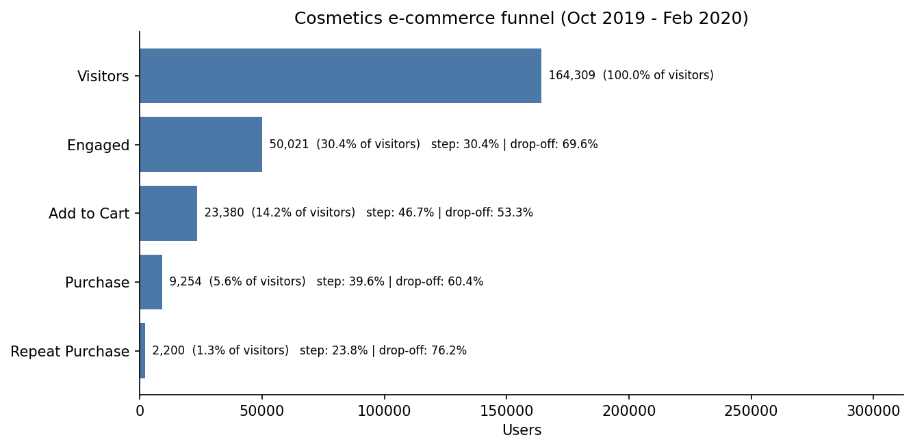
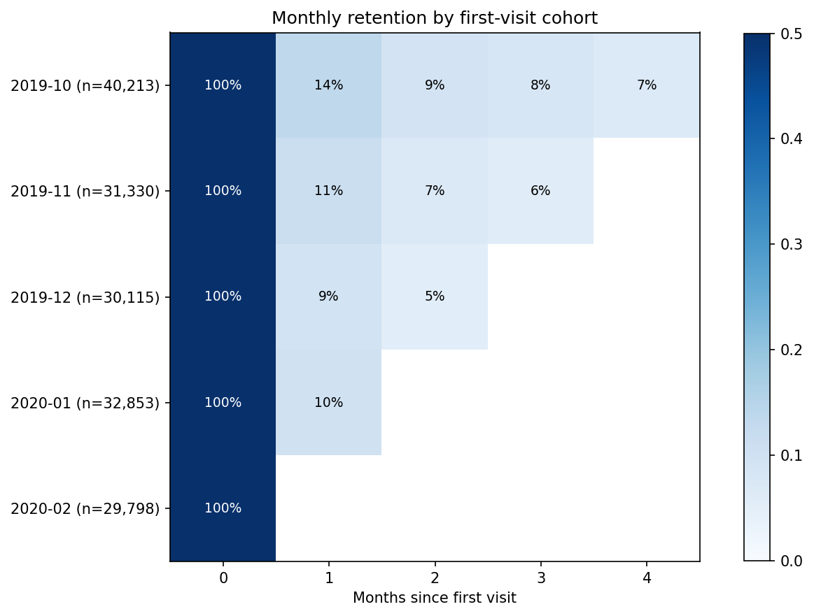
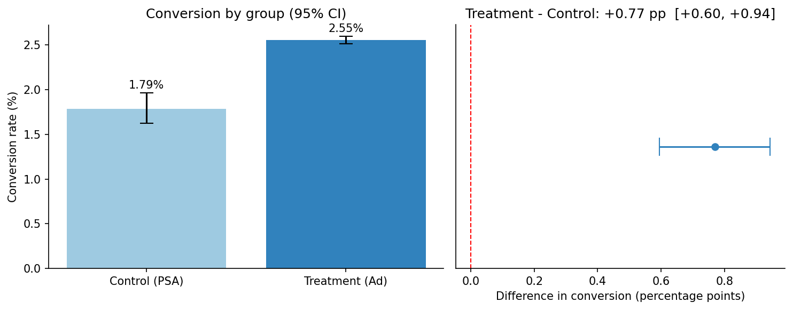

# Growth & Funnel Analytics: E-ticaret Funnel, Retention ve A/B Test Analizi

🇬🇧 English: [README.md](README.md)

**Gerçek veri** üzerinde (1,6 milyon kullanıcı, 16,7 milyon olay, 588 bin kullanıcılı A/B testi) uçtan uca bir ürün/growth analitiği projesi. Bir growth ekibinin her hafta sorduğu üç soruya cevap verir:

1. **Funnel:** Kullanıcılar ilk ziyaretten tekrar satın almaya giderken hangi adımda kayboluyor?
2. **Cohort ve retention:** Kullanıcılar geri geliyor mu, edinim ayına göre fark var mı?
3. **Deney:** Pazarlama müdahalesi conversion'ı *gerçekten* artırdı mı? Sonuç; hipotez, güven aralığı, p-değeri ve etki büyüklüğüyle raporlanır, "B daha iyi" demekle yetinilmez.

## Temel bulgular

- **Ziyaretçilerin yalnızca %5,6'sı satın alıyor, %1,4'ü tekrar alıyor.** En büyük mutlak kayıp ilk adımda: ziyaretçilerin %69,7'si 3 ürün görüntülemeye bile ulaşmıyor.
- **Sepet terk oranı %53**; sepete ekleyenlerin **%60'ı** gözlem döneminde satın almıyor.
- **Retention düşük:** bir cohort'un ortalama **%10,1'i** 1. ayda, **%6,1'i** 2. ayda geri dönüyor.
- **Reklam kampanyası işe yaradı:** conversion %1,79'dan (control) %2,55'e (treatment) yükseldi: **+0,77 yüzde puan** (%95 GA [+0,60, +0,94]; göreli artış %43), **p < 0,0001**. Reklam gören 564 bin kullanıcıda yaklaşık **4,3 bin ek dönüşüm** demek (GA ≈ 3,4 bin - 5,3 bin).
- Taban oran düşük olduğu için standartlaştırılmış etki büyüklüğü küçük (Cohen's h = 0,053); iş değeri, ek dönüşüm başına kampanya maliyetine bağlı.

## Veri (repoda yok, "Veriyi indir" bölümüne bak)

| Bölüm | Veri seti | Kullanım |
|---|---|---|
| Funnel, cohort | [eCommerce Events History in Cosmetics Shop (REES46)](https://www.kaggle.com/datasets/mkechinov/ecommerce-events-history-in-cosmetics-shop): olay logu (`view`, `cart`, `purchase`), Ekim 2019 - Şubat 2020, 1.639.358 kullanıcı, 155.617 sipariş | Notebook 01, 02 |
| A/B test | [Marketing A/B Testing](https://www.kaggle.com/datasets/faviovaz/marketing-ab-testing): 588.101 kullanıcı, `ad` (treatment) ve `psa` (control), ikili `converted` | Notebook 03 |

## Metodoloji

**Funnel (kullanıcı bazlı, katı: her aşama bir öncekinin alt kümesi)**

`Visitors → Engaged (≥3 ürün görüntüleme) → Add to Cart → Purchase → Repeat Purchase (≥2 sipariş)`

Olay logunda sign-up/activation olayı olmadığı için *Engaged* aşaması activation yerine proxy olarak kullanıldı. Her adım için adım dönüşümü, drop-off oranı ve genel dönüşüm raporlanır; ayrıca Engaged eşiği için duyarlılık analizi ve edinim cohort'una göre funnel verilir.

**Cohort:** cohort = kullanıcının ilk olayının ayı; retention(k) = cohort'un *M+k* ayında aktif olan payı. Henüz gözlenmemiş hücreler 0 değil boş bırakılır. İlk ay, mevcut müşterileri de içerdiği için (sola kesik) ayrıca işaretlenir.

**A/B test**

| Madde | Tercih |
|---|---|
| H0 / H1 | p_treatment = p_control / p_treatment ≠ p_control (iki yönlü) |
| Test | İki oran z-testi (pooled), chi-square ile çapraz kontrol |
| Aralık | Mutlak farkın %95 güven aralığı + göreli artış için bootstrap GA |
| Etki büyüklüğü | Cohen's h, odds ratio, göreli artış |
| Güç | Tespit edilebilir minimum etki ve gerekli örneklem |
| Segmentler | Gün/saat bazında, Bonferroni düzeltmesiyle (keşifsel) |

## Sonuçlar

### 1. Funnel

| Aşama | Kullanıcı | Adım dönüşümü | Adım kaybı | Tüm ziyaretçilere oran |
|---|---:|---:|---:|---:|
| Visitors | 1.639.358 | - | - | %100 |
| Engaged (≥3 görüntüleme) | 496.856 | %30,3 | %69,7 | %30,3 |
| Add to Cart | 231.983 | %46,7 | %53,3 | %14,2 |
| Purchase | 91.986 | %39,7 | %60,3 | %5,6 |
| Repeat Purchase (≥2 sipariş) | 22.538 | %24,5 | %75,5 | %1,4 |



- En büyük **mutlak** kayıp Visitors → Engaged adımında (yaklaşık 1,14 milyon kullanıcı). En büyük **göreli** kayıp tekrar satın almadan önce: alıcıların %75,5'i ikinci kez almıyor.
- Alıcıların yalnızca **%24,5'i** ikinci kez satın alıyor.

### 2. Cohort ve retention

| Cohort (ilk ziyaret) | Kullanıcı | 1. ay | 2. ay | 3. ay | 4. ay |
|---|---:|---:|---:|---:|---:|
| 2019-10* | 399.664 | %13,7 | %9,1 | %7,9 | %6,7 |
| 2019-11 | 313.436 | %11,0 | %7,0 | %5,6 | - |
| 2019-12 | 299.461 | %9,2 | %5,2 | - | - |
| 2020-01 | 328.938 | %10,1 | - | - | - |
| 2020-02 | 297.859 | - | - | - | - |

\*İlk cohort, mevcut müşterileri de içerir (sola kesik), bu yüzden temiz bir yeni kullanıcı cohort'u değildir. Bunu hariç tutan ağırlıklı ortalama retention: **1. ay = %10,1**, **2. ay = %6,1**, 3. ay = %5,6 (tek cohort).



Cohort funnel'larında alıcı oranı %8,5'ten (Ekim) %3,1'e (Şubat), tekrar alım oranı %3,1'den %0,25'e düşüyor. Bu düşüş **kısmen gözlem süresi etkisidir**: sonraki cohort'ların satın alması veya tekrar satın alması için daha az zamanı oldu (Ekim cohort'u ayrıca mevcut müşterileri içeriyor). Dolayısıyla bu sayılar tek başına müşteri kalitesinin düştüğünü göstermez.

### 3. A/B test: reklam (ad) vs. PSA (control)

| Metrik | Control (PSA) | Treatment (Ad) |
|---|---:|---:|
| Kullanıcı | 23.524 | 564.577 |
| Dönüşüm | 420 | 14.423 |
| Conversion oranı | %1,79 | %2,55 |

| İstatistik | Değer |
|---|---|
| Mutlak fark | **+0,77 pp** (%95 GA [+0,60, +0,94]) |
| Göreli artış | **%43,1** (%95 bootstrap GA [%30,6, %57,8]) |
| z / p-değeri | z = 7,37, **p = 1,7e-13** (chi-square aynı p'yi verir) |
| Cohen's h / odds ratio | h = 0,053 (standartlaştırılmış olarak küçük) / OR = 1,44 |
| Tespit edilebilir minimum etki | %80 güçte 0,25 pp (test yeterince güçlüydü) |




**Segmentler (keşifsel, Bonferroni düzeltmeli):** artış **Salı (+1,60 pp)**, **Pazartesi (+1,07 pp)** ve **Çarşamba (+0,96 pp)** günlerinde anlamlı; Perşembe (+0,14 pp), Pazar (+0,40 pp), Cuma ve Cumartesi için düzeltmeden sonra anlamlı değil.

## Öneriler

1. **Funnel'ın üstünü düzelt:** 10 ziyaretçiden 7'si 3 ürün görüntülemeye ulaşmıyor. Daha iyi arama, öneri ve açılış sayfası testleri yap.
2. **Sepet terkini (%53) azalt:** hatırlatmalar ve ödeme sürtünmesi testleriyle. Notebook 03'teki gibi bir A/B testi en iyi burada işe yarar.
3. **Tekrar alım programı kur** (kozmetik gibi tüketilen ürünler için yenileme hatırlatmaları): alıcıların yalnızca %24,5'i geri dönüyor, bir cohort'un %10'u 1. ayda aktif.
4. **Kampanya kârlıysa sürdür:** ~4,3 bin ek dönüşümü kampanya harcamasıyla (ek dönüşüm başına maliyet) karşılaştır. Etki haftanın başında daha güçlü göründüğü için gün bazlı hedefleme testi yap (keşifsel, doğrulama gerekir).

## Proje yapısı

```
├── data/raw/                 # Kaggle dosyalarını buraya koy (git'e girmez)
├── data/processed/           # üretilen kullanıcı bazlı tablolar (git'e girmez)
├── notebooks/
│   ├── 01_funnel_analysis.ipynb
│   ├── 02_cohort_retention.ipynb
│   └── 03_ab_test.ipynb
├── src/                      # data_prep, funnel, cohort, ab_test, plots, summary
├── tests/                    # birim + uçtan uca testler (küçük sahte veriyle)
├── outputs/                  # grafikler ve tablolar
└── requirements.txt
```

## Veriyi indir ve çalıştır

```bash
pip install -r requirements.txt

# Yukarıdaki Kaggle linklerinden elle indir, sonra:
# data/raw/cosmetics/*.csv   ve   data/raw/marketing_AB.csv

python -m src.data_prep        # kullanıcı bazlı tabloları üret (hızlı deneme için --sample 10)
python -m src.summary          # tüm özet rakamları yazdır
jupyter lab                    # 01 -> 03 notebook'larını çalıştır
pytest -q                      # testler
```

## Sınırlılıklar

- Funnel gözlemseldir; *Engaged* activation için bir proxy'dir (logda sign-up olayı yok).
- Cohort karşılaştırmaları farklı gözlem sürelerinden etkilenir; ilk cohort (Ekim 2019) mevcut müşterileri içerir.
- A/B veri setinde gruplar tasarım gereği çok dengesizdir (~%96 / %4), gelir veya maliyet verisi yoktur ve randomizasyon sürecini doğrulayamadım. İstatistiksel anlamlılık, iş açısından anlamlılık demek değildir.
- Segment sonuçları keşifseldir (gün, en çok reklam görülen gündür).

## Teknolojiler
Python, pandas, NumPy, SciPy, Matplotlib, Jupyter, pytest.